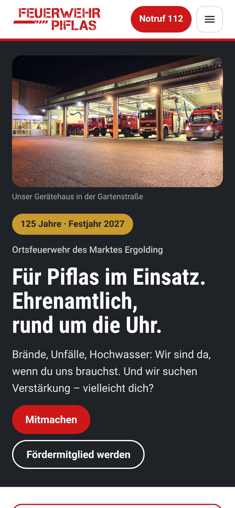
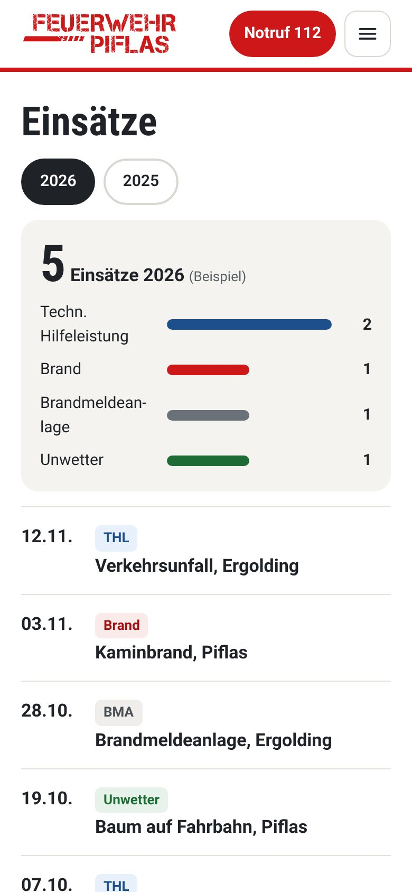
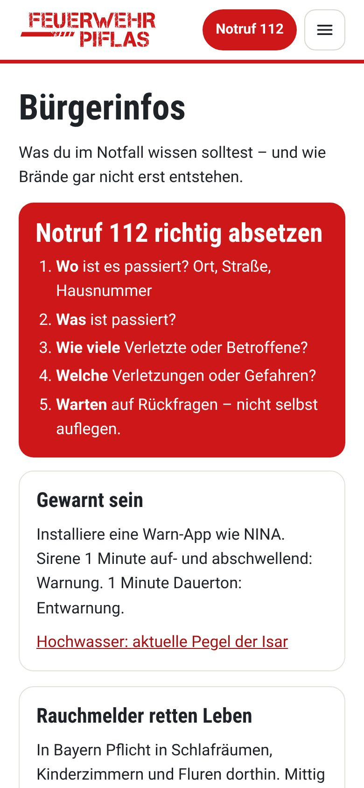
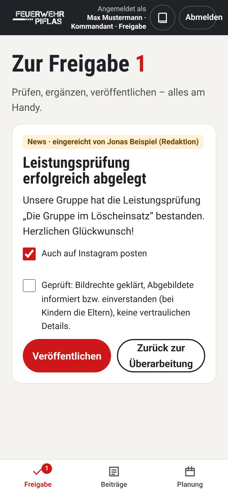

# Website Feuerwehr Piflas

Planung, klickbare Demo und Dokumentation für die neue Website der Feuerwehr Piflas e.V. (www.feuerwehr-piflas.de). Die Feuerwehr Piflas ist eine Ortsfeuerwehr des Marktes Ergolding.

[](https://github.com/KWildwasser/feuerwehr-piflas-website/actions/workflows/demo-tests.yml)

### ▶ [Demo ausprobieren](https://kwildwasser.github.io/feuerwehr-piflas-website/demo/) · [Projektseite](https://kwildwasser.github.io/feuerwehr-piflas-website/) · [Lastenheft (PDF)](docs/lastenheft/Lastenheft-Feuerwehr-Piflas-v1.16.pdf) · [Handbuch (PDF)](docs/handbuch/Handbuch-Website-Feuerwehr-Piflas.pdf)

<p>




</p>

*Bildschirmfotos aus der Demo – alle Inhalte sind Beispiele.*

## Worum es geht

- **WordPress** auf dem Vereins-Hosting mit eigenem Theme und Plugin. Ausgewählte Mitglieder pflegen die Seite mit eigenen Konten, am Handy und ohne IT-Kenntnisse.
- **Einsätze und Termine** kommen automatisch aus DIVERA 24/7 – datensparsam und erst nach Freigabe durch den Kommandanten.
- **Instagram:** freigegebene Beiträge werden auf Wunsch gepostet, die Vorschau kommt ohne Einbettung und ohne Cookies.
- **Rechtssicher:** keine Drittanbieter, keine Spenden online (Satzung), keine erkennbaren Einsatzbetroffenen.

## Inhalt

| Ordner | Was |
|---|---|
| [`docs/demo/`](docs/demo/) | Referenz-Demo (eine HTML-Datei, statisch) mit Testsuite – [README](docs/demo/README.md) |
| [`docs/lastenheft/`](docs/lastenheft/) | Lastenheft v1.16 als [Text](docs/lastenheft/lastenheft-v1.16.md) und [PDF](docs/lastenheft/Lastenheft-Feuerwehr-Piflas-v1.16.pdf), Vorlagen für Claude Code |
| [`docs/handbuch/`](docs/handbuch/) | [Handbuch Mitgliederbereich 1.15](docs/handbuch/Handbuch-Website-Feuerwehr-Piflas.pdf) mit Quellen |
| [`docs/design/`](docs/design/) | [Corporate Design](docs/design/corporate-design.md), frühe Entwürfe |
| [`docs/assets/`](docs/assets/) | Logo, Schrift (Roboto, OFL), Fotos, Briefpapier |
| [`docs/uebergangsseite/`](docs/uebergangsseite/) | Übergangsseite zum Hochladen |
| [`docs/WEITERMACHEN.md`](docs/WEITERMACHEN.md) | Stand, Entscheidungen, nächste Schritte (Pfade dort relativ zu `docs/`) |

## Demo ändern

```bash
pip install playwright pillow markdown pypdf && python -m playwright install chromium
cd docs/demo
python build.py        # baut index.html aus app-src.html und ../assets
python test_app.py     # 700 Prüfungen, Exit-Code 1 bei Fehlern
```

Bei jedem Push prüft GitHub Actions die Demo automatisch ([Workflow](.github/workflows/demo-tests.yml)). Reihenfolge bei Änderungen: Lastenheft (ID) → Demo → Prüfung → Handbuch → PDFs.

## Hinweise

- Die Demo enthält nur **Beispielinhalte und Beispielpersonen**. Termine, Einsätze und Namen sind erfunden oder als [Platzhalter] markiert.
- Dies ist keine Rechtsberatung. Die rechtlichen Punkte (Lastenheft 3.1) prüft vor dem Go-live eine Fachperson.
- Fotos: Feuerwehr Piflas. Schrift: Roboto unter SIL Open Font License (`docs/assets/fonts/OFL.txt`).
